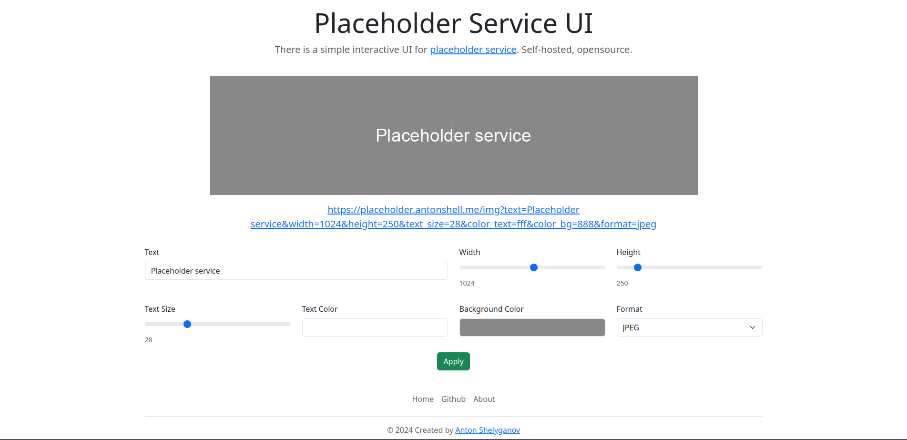
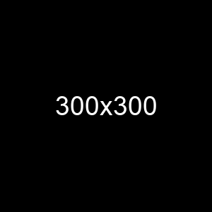

# Placeholder service

There is a simple self-hosted service for images placeholders generation.

[Frontend](https://placeholder-ui.antonshell.me/), [Backend](https://placeholder.antonshell.me/)


# Install in docker

1 . Clone repository

```
git clone git@github.com:antonshell/placeholder-service.git
```

2 . Run containers

```
cd placeholder-service
docker compose up -d
```

The local stack uses the `dev` target of the same `Dockerfile` as production (FrankenPHP + xdebug).
Containers run as your host user (`HOST_UID`/`HOST_GID`, default `1000`), so generated files belong to you.
For step debugging start with `XDEBUG_MODE=debug,coverage docker compose up -d` and use the `XDEBUG_TRIGGER` cookie/param.

3 . Install dependencies

```
docker compose exec app composer install
```

4 . Open in browser

[http://127.0.0.1:16880/](http://127.0.0.1:16880/) - Healthcheck

[http://127.0.0.1:16880/img](http://127.0.0.1:16880/img) - Default image

# Demo

There is a SaaS version available:
[https://placeholder.antonshell.me/img?width=500](https://placeholder.antonshell.me/img?width=500)

And also UI available:
[https://placeholder-ui.antonshell.me/](https://placeholder-ui.antonshell.me/)



There is a separate project:
[https://github.com/antonshell/placeholder-service-ui](https://github.com/antonshell/placeholder-service-ui)

# Usage

1 . Healthcheck

[https://placeholder.antonshell.me/](https://placeholder.antonshell.me/)

2 . Get default image (300x300)

[https://placeholder.antonshell.me/img](https://placeholder.antonshell.me/img)


3 . Set image size

- Set width
[https://placeholder.antonshell.me/img?width=500](https://placeholder.antonshell.me/img?width=500) - 500x500


- Set height
[https://placeholder.antonshell.me/img?height=400](https://placeholder.antonshell.me/img?height=400) - 400x400


- Set width & height
[https://placeholder.antonshell.me/img?width=320&height=240](https://placeholder.antonshell.me/img?width=320&height=240) - 320x240


4 . Set custom text

[https://placeholder.antonshell.me/img?text=Hello](https://placeholder.antonshell.me/img?text=Hello)


5 . Set text size (default: 28)

[https://placeholder.antonshell.me/img?width=800&text_size=40](https://placeholder.antonshell.me/img?width=800&text_size=40)


6 . Set text color

[https://placeholder.antonshell.me/img?color_text=000](https://placeholder.antonshell.me/img?color_text=000)


7 . Set background color

[https://placeholder.antonshell.me/img?color_bg=000](https://placeholder.antonshell.me/img?color_bg=000)



8 . Set format (PNG, JPEG, GIF)

[https://placeholder.antonshell.me/img?format=png](https://placeholder.antonshell.me/img?format=png)


[https://placeholder.antonshell.me/img?format=jpeg](https://placeholder.antonshell.me/img?format=jpeg)


[https://placeholder.antonshell.me/img?format=gif](https://placeholder.antonshell.me/img?format=gif)


# Deploy (production)

Production runs as a single [FrankenPHP](https://frankenphp.dev) container behind the existing Caddy container (`/srv/proxy`).
Every push to `master` runs `.github/workflows/ci.yml`: lint, audit, tests and the image build run in parallel.
The build job smoke-tests the image and pushes it to `ghcr.io/antonshell/placeholder-service` only if it passes;
the deploy job restarts the stack on the server via SSH only when lint, tests and build are green.
The audit job (`composer audit`) and Psalm are informational: findings show up as warnings and never block deploy.
The 10 most recent images are kept in GHCR as rollback targets.

## One-time server setup

Server layout: Caddy lives in `/srv/proxy` (compose + Caddyfile) and is attached to the external docker network `web`.
The app stack lives in `/srv/placeholder-service`.

1 . Create a deploy user with docker access (if it doesn't exist yet) and a directory for the stack

```
sudo useradd --create-home --shell /bin/bash --groups docker deployment && sudo usermod --password '*' deployment
sudo mkdir -p /srv/placeholder-service && sudo chown deployment:deployment /srv/placeholder-service
```

Add the public part of the deploy SSH key to `/home/deployment/.ssh/authorized_keys`.

2 . Add the site to `/srv/proxy/Caddyfile` (see `deploy/Caddyfile.example`) and reload Caddy

```
placeholder.antonshell.me {
	encode zstd gzip
	reverse_proxy placeholder-service:8080
}

# old domain with a typo: permanent redirect to the main one
placehloder.antonshell.me {
	redir https://placeholder.antonshell.me{uri} permanent
}
```

```
cd /srv/proxy && docker compose exec caddy caddy reload --config /etc/caddy/Caddyfile
```

## GitHub configuration

Settings → Environments → `production` → secrets:

| Secret           | Example                          |
|------------------|----------------------------------|
| `DEPLOY_HOST`    | server IP / hostname             |
| `DEPLOY_PORT`    | `22` (optional)                  |
| `DEPLOY_USER`    | `deployment`                     |
| `DEPLOY_SSH_KEY` | private key (ed25519)            |
| `DEPLOY_PATH`    | `/srv/placeholder-service`       |
| `APP_SECRET`     | output of `openssl rand -hex 32` |

## Build the production image locally

```
docker build -t placeholder-service .
docker run --rm -p 8080:8080 -e APP_SECRET=dev placeholder-service
```

## Smoke test of the production image

`.github/scripts/smoke-test.sh` starts the image and checks what PHPUnit can't see in the real container:

- the container becomes `healthy`, `/` returns `200` with JSON (not in debug mode), an unknown route returns `404`
- images are generated in the prod container: PNG, JPEG and GIF of the requested size, custom text
  (GD with FreeType and the font from `resources/fonts`), an unsupported format returns `400`
- `/favicon.ico` is served as a static file with `Cache-Control: public, max-age=604800`

It runs in CI before the image is pushed to GHCR; to run it locally:

```
docker build --target prod -t placeholder-service:prod .
.github/scripts/smoke-test.sh placeholder-service:prod
```

The container is published on `127.0.0.1:18099` (override with `SMOKE_PORT=...`) and removed afterwards;
on failure the script prints the failed checks and the container logs and exits with code `1`.

# Tests

1 . Run tests

Local environment:
```
composer test
```

Docker environment:
```
docker compose exec app composer test
```

Generated images are compared pixel by pixel with `resources/test_images_docker` in docker
(`DOCKER_ENVIRONMENT` is set in the dev image) and with `resources/test_images` otherwise.
In CI tests run in the same dev image; the coverage report is in the job summary and in the **coverage** artifact of the run.

2 . Update code coverage badges

Local environment:
```
composer update-badges
```

Docker environment:
```
docker compose exec app composer update-badges
```

# Codestyle

1 . Fix codestyle

```
composer cs-fixer src
docker compose exec app composer cs-fixer src
```

2 . Code quality with Psalm

```
composer psalm
composer psalm-report-html

docker compose exec app composer psalm
docker compose exec app composer psalm-report-html
```

Open in browser: psalm-report.html


3 . Static analysis with PHPStan

```
docker compose exec app vendor/bin/phpstan analyse
```

# Composer require checker

```
wget https://github.com/maglnet/ComposerRequireChecker/releases/download/4.10.0/composer-require-checker.phar
docker compose exec app composer require-check
```

More details: [https://github.com/maglnet/ComposerRequireChecker](https://github.com/maglnet/ComposerRequireChecker)
